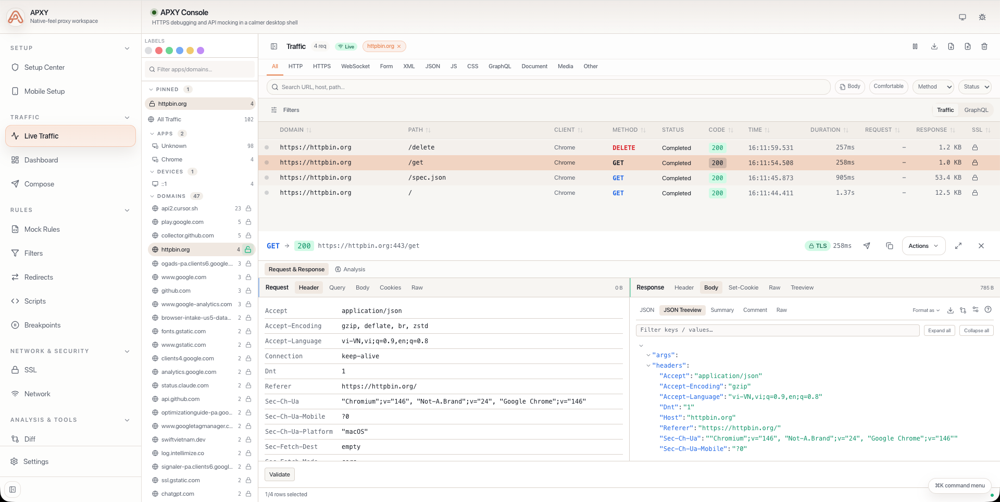

# APXY

[](#install)

APXY checks a code change against the HTTP request that the code sends. Your coding agent changes the code, runs it through APXY, waits for the request it expects, and asserts on that request. The agent reads pass or fail from the exit code, so the result comes from captured traffic and not from the agent's own report.

```bash
apxy mark
apxy run -- python3 checkout.py
apxy wait --match "POST /v1/charges" --expect "req.body.amount == 4200"
```

In this example, `checkout.py` sends the amount in dollars, and the payments API expects cents. `apxy wait` finds the request, fails the check, and prints the value that it saw:

```text
✗ POST http://localhost:4010/v1/charges → 200  (id 03363ab01de47323, 2026-11-22T09:16:18.704+07:00)
  ✗ req.body.amount == 4200  (actual: "42")
Next: apxy logs show --id 03363ab01de47323
Error: Wait: assertion failed: req.body.amount == 4200
$ echo $?
7
```

| Exit code | Meaning |
|-----------|---------|
| `0` | A request matched and every `--expect` passed. |
| `7` | A request matched, but an `--expect` failed. The output shows the actual value. |
| `8` | No request matched before the timeout. The default timeout is 30s. |

- `apxy mark` records the current time, so `apxy wait` ignores requests from earlier attempts.
- `apxy run` starts one command with the proxy and certificate settings. When no proxy is running, it starts a temporary proxy on 127.0.0.1. The temporary proxy needs no sudo and does not change the system proxy.
- When stdout is not a terminal, `apxy wait` prints JSON with `"ok": false` and the actual values in `data.expectations[].actual`.
- For an HTTPS host, put `--ssl-domains <host>` before the `--`, as in `apxy run --ssl-domains api.example.com -- npm test`. Without it, APXY records only a `CONNECT` tunnel, with no path or body.

## Install

Install with Homebrew on macOS or Linux:

```bash
brew tap apxydev/apxy https://github.com/apxydev/apxy
brew install apxy
```

Or install with the shell script:

```bash
curl -fsSL https://apxy.dev/install.sh | bash
```

`apxy mark`, `apxy run`, and `apxy wait` are in APXY v1.4.0 and later.

## Use APXY with your coding agent

### Use with Claude Code

Install the APXY plugin from inside Claude Code:

```
/plugin marketplace add apxydev/apxy
/plugin install apxy@apxy
```

The plugin adds the APXY MCP server and the APXY skill. The skill tells Claude to run the check above after it changes code that sends or serves HTTP requests. Install the `apxy` binary first, because the MCP server runs `apxy mcp`. The MCP tools `set_mark` and `wait_for_request` run the same check, and they ship in the next APXY release.

### Use with other agents

Install the APXY skill. It works with Cursor, Codex, Gemini CLI, GitHub Copilot, and other agents that support [skills](https://github.com/vercel-labs/skills).

```bash
npx skills add apxydev/apxy
```

Or connect APXY as an MCP server. This command prints the setup for each supported client:

```bash
apxy setup mcp --all
```

Then ask your agent things like:

> "Fix the checkout bug, then prove it with APXY: the POST to /v1/charges must send amount 4200."
>
> "After you change the signup form, check with APXY that POST /api/users returns 201."
>
> "Mock POST /api/payments to return a 402 card error so I can test the error screen."

## Tools the loop uses

The rest of APXY sets up the request that you check, or shows why a check failed. The [user guide](docs/user-guide.md) shows the commands for each of these:

- [Mock an API](docs/user-guide.md#mock-rules) that is broken or not built yet.
- [Find and inspect requests](docs/user-guide.md#traffic-capture--inspection) by URL, header, or body.
- [Replay a request](docs/user-guide.md#export--replay) after a fix, or export it as a curl command.
- [Diff two requests](docs/user-guide.md#diff) to see what your fix changed.
- [Slow down the network](docs/user-guide.md#network-conditions) to test loading states and timeouts.

## Watch traffic in the Web UI



This takes about two minutes. You start the proxy, send one request through it, and look at what APXY captured.

> [!NOTE]
> APXY records the full body of an HTTPS request only for domains that you turn on. Other HTTPS traffic shows up as a `CONNECT` line with the host name and no body. Turn on a domain with `--ssl-domains` when you start APXY, or later with `apxy ssl enable --domain <host>`.

1. Start the proxy and turn on HTTPS capture for `httpbin.org`:

   ```bash
   apxy start --ssl-domains httpbin.org
   ```

   On the first run on macOS, APXY creates a certificate and asks for your password to trust it. It also turns on the system proxy, so your browser and apps go through APXY.

2. In a second terminal, send a request through APXY:

   ```bash
   apxy run curl https://httpbin.org/get
   ```

3. Look at the request. Open the Web UI at <http://localhost:8082>, or list it in the terminal:

   ```bash
   apxy logs list --limit 5
   ```

   You see a `GET` to `https://httpbin.org:443/get` with status `200`.

4. Stop the proxy when you are done:

   ```bash
   apxy stop
   ```

   APXY turns the system proxy off again.

On Linux, start with `apxy start --no-system-proxy` and send traffic through `apxy run`.

## Free and Pro

The Free plan has every feature and needs no account. Each Free proxy session stops after 10 minutes. Run `apxy start` again to start a new session. [APXY Pro](https://apxy.dev/license) removes the time limit.

## Learn more

- [Getting started](docs/getting-started.md) has the full install and first-run guide.
- [User guide](docs/user-guide.md) covers every feature.
- [Troubleshooting](docs/troubleshooting.md) and the [FAQ](docs/faq.md) answer common problems.
- [Examples](examples/README.md) walk through real debugging, mocking, and AI agent workflows.
- [Mock templates](mock-templates/README.md) give you ready-made mocks for Stripe, GitHub, and OpenAI.
- [apxy.dev/docs](https://apxy.dev/docs) has the online docs.

## Contribute and get help

- Read [CONTRIBUTING.md](CONTRIBUTING.md) to add a mock template, an example, or a fix.
- [Open an issue](https://github.com/apxydev/apxy/issues) to report a bug or ask for a feature.
- Read [SECURITY.md](SECURITY.md) to report a security problem.
- Email [support@apxy.dev](mailto:support@apxy.dev) for anything else.
